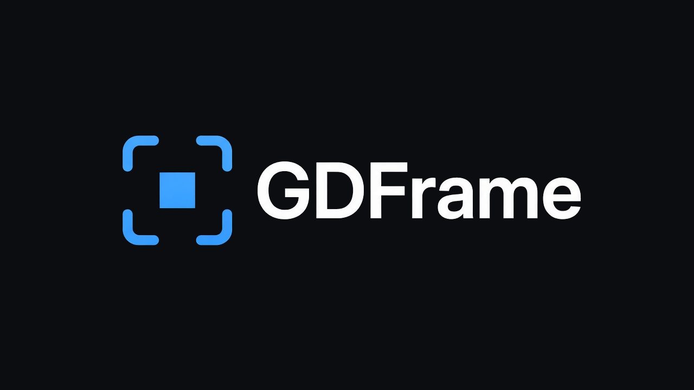

<p align="center"></p>

# GDFrame

面向 Godot 4.7+ 的 GDScript 游戏框架。启用插件即可获得菜单与弹窗管理、键鼠与手柄导航、显示与语言设置，以及玩家档案。用同一套基础能力做原型、开发正式项目，也可以按需加入音频、对象池等扩展。

## 从菜单原型到游戏发布

- **在 Godot 里完成配置。** 从底部 GDFrame Dock 创建界面、设置图层和遮罩、编辑档案默认值、维护翻译。界面仍然使用普通的 Godot 场景和脚本，团队可以直接在编辑器里调整。
- **在合适的时机准备界面。** 可在加载画面中预加载菜单或弹窗，打开时同步显示。UI 图层按需创建，已预加载的界面实例可以复用，多层弹窗共用一个遮罩。
- **运行时按项目需要加载。** 项目配置场景列出启用的扩展，游戏启动时按清单初始化。保持插件启用进行导出，即使选择「导出所有资源」，GDFrame 也会排除未启用的 GDFrame 模块和编辑器工具。
- **项目依赖一眼可查。** 通过 `GDFrame.ui`、`GDFrame.settings` 等入口调用基础能力。扩展依赖集中在配置场景，业务代码可使用带类型提示的项目入口，便于补全、跳转和维护。

## 快速开始

1. 将 `addons/gdframe/` 复制到 Godot 项目的 `addons/` 下，在「项目 → 项目设置 → 插件」启用 GDFrame。
2. 打开编辑器底部的「GDFrame」。插件会创建 `res://gdframe_project/gdframe.tscn` 并注册 `GDFrame` Autoload。将这个场景和 `project.godot` 一起纳入版本控制。
3. 在「UI 管理」输入 `main_menu` 并创建，得到注册好的 `ui_main_menu` 界面。在游戏入口脚本中预加载并打开它。

```gdscript
func _ready() -> void:
	await GDFrame.ui.preload_ui(&"ui_main_menu")
	GDFrame.ui.open(&"ui_main_menu")
```

可在场景根节点的检查器中设置默认图层、是否使用遮罩、是否参与导航。自己的界面可以通过 `GDFrame.ui.register_scene()` 注册，根节点脚本继承 `GDFrameUIBase`。

## 游戏代码入口

| 入口 | 用途 |
| --- | --- |
| `GDFrame.ui` | 注册、预加载、打开与关闭界面，管理图层、遮罩和焦点 |
| `GDFrame.input` | 识别键盘、鼠标、触屏和手柄，监听设备切换 |
| `GDFrame.settings` | 读写显示模式、窗口尺寸、帧率上限、垂直同步和语言 |
| `GDFrame.save` | 保存玩家档案、基础设置和扩展状态，支持中断保存后的恢复 |
| `GDFrame.get_service(id)` | 获取已注册的扩展服务 |

### 安装扩展

在「扩展管理 → 在线安装与更新」选择下载源并点击「检查更新」。安装所需扩展后，切到「已安装」启用。也可以从扩展仓库复制所需的 `addons/gdframe_<id>/` 目录，再回到 Dock 启用。可点击「生成项目类型入口」，为业务代码添加带类型提示的服务属性。[GDFrame 扩展仓库](https://github.com/ftyu3d/gdframe-ext)

### 打包游戏

导出时保持 GDFrame 插件启用。停用某个模块前，检查业务代码是否仍引用它的脚本或资源。选择性导出时，使用 `PackedScene` 等资源属性引用项目资产，并将仅由字符串路径加载的资源纳入导出预设。

[使用指南与扩展开发](addons/gdframe/editor/README.md) · [MIT 许可证](LICENSE)
